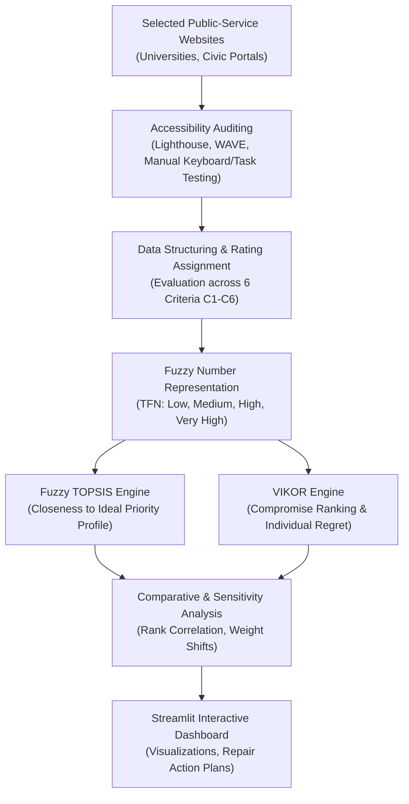

# SmartWeb Access: Project Specification & Research Proposal

**Proposed Title:**  
*A Fuzzy TOPSIS and VIKOR-Based Decision Support System for Prioritizing Accessibility Repairs on Public-Service Websites*

**Project Code:** P35  
**Domain:** Soft Computing / Multi-Criteria Decision Making (MCDM) / Web Accessibility (WCAG 2.1/2.2)

---

## 1. Executive Summary & Problem Statement

Public-service websites (such as university portals, civic service registries, public libraries, and municipal platforms) often contain numerous accessibility barriers. These barriers disproportionately impair users with visual, motor, auditory, or cognitive disabilities from completing critical tasks.

Common accessibility barriers include:
- Insufficient color contrast rendering text unreadable.
- Form inputs lacking explicit accessible names/labels or actionable validation errors.
- Keyboard trap issues or interactive controls missing focus indicators.
- Non-text content (images, icons) lacking semantic `alt` attributes.
- Flawed heading hierarchies and disordered DOM structures confusing screen readers.
- Critical transactional workflows (applying, paying, registering) that are inaccessible or broken.

### The Core Problem
Automated audit tools (WAVE, Axe, Lighthouse) typically produce raw, unweighted lists of hundreds or thousands of errors. Web administrators and development teams operate under finite time, budget, and labor constraints. Deciding which issues to remediate first is often ad-hoc or driven solely by error frequency rather than user-task criticality. 

**SmartWeb Access** resolves this by providing a Soft Computing-driven Decision Support System (DSS) that systematically ranks accessibility repairs using **Fuzzy TOPSIS** and **VIKOR**, emphasizing barriers that obstruct essential user journeys.

---

## 2. System Architecture & Workflow

---

## 3. Decision Criteria Model (C1 – C6)

Each identified accessibility defect is evaluated across six defined criteria:

| Criterion | Metric / Focus | Optimization Goal | Linguistic Scale |
| :--- | :--- | :--- | :--- |
| **C1. Barrier Severity** | Technical severity of the WCAG violation (Level A, AA, AAA violation severity) | Benefit (Higher = Higher Priority) | Low, Medium, High, Very High |
| **C2. Essential-Task Impact** | Degree to which the barrier halts completion of core tasks (admissions, payment, login) | Benefit (Higher = Higher Priority) | Low, Medium, High, Very High |
| **C3. Affected Page Count** | Breadth of occurrence across audited pages | Benefit (More pages = Higher Priority) | Integer count / Scaled Fuzzy |
| **C4. User Impact** | Size and vulnerability of affected user groups (screen-reader users, motor-impaired) | Benefit (Greater impact = Higher Priority) | Low, Medium, High, Very High |
| **C5. Repair Effort** | Estimated developer time and architectural complexity to fix | Cost (Lower effort can boost priority / quick wins) | Very Low, Low, Medium, High |
| **C6. Issue Frequency** | Instance count per page or repeatability | Benefit (Higher recurrence = Higher Priority) | Numerical / Scaled Fuzzy |

> [!NOTE]
> Severity (C1) and Essential-Task Impact (C2) are intentionally decoupled. A minor visual flaw on an essential application form may completely block submission, whereas a severe violation on an unused informational footer may have negligible task impact.

---

## 4. Soft Computing Methodologies

### 4.1 Fuzzy TOPSIS (Technique for Order Preference by Similarity to Ideal Solution)
- Converts qualitative criteria into Triangular Fuzzy Numbers (TFNs).
- Normalizes the fuzzy decision matrix.
- Calculates the **Fuzzy Positive Ideal Solution ($A^*$)** and **Fuzzy Negative Ideal Solution ($A^-$)**.
- Determines the closeness coefficient ($CC_i$) for each candidate repair.

### 4.2 VIKOR (ViseKriterijumska Optimizacija I Kompromisno Resenje)
- Focuses on ranking and selecting from a set of alternatives in the presence of conflicting criteria (e.g., High Task Impact vs. High Repair Effort).
- Computes utility measure ($S_i$) representing group utility, and regret measure ($R_i$) representing individual regret.
- Calculates the compromise index ($Q_i$) to provide a compromise solution with an acceptable advantage and stability.

### 4.3 Comparative Engine
- Measures Spearman's rank correlation coefficient ($\rho$) between Fuzzy TOPSIS and VIKOR outputs.
- Explains divergence where trade-offs between effort (C5) and task criticality (C2) lead to differing rankings.

---

## 5. Data Collection Strategy

- **Sample Target:** 5 Public-Service Websites (e.g., public universities, state services, municipal portals).
- **Page Sampling:** 5–10 critical pages per website (Homepage, Service Directory, Application/Registration Form, Payment/Fee Portal, Search/Contact).
- **Auditing Toolchain:**
  - Automated: Google Lighthouse CLI / PageSpeed Insights API, WAVE Evaluation Tool.
  - Manual Verification: Tab-order navigation, keyboard-only form submission, focus indicator verification, screen-reader spot checks.

---

## 6. Research Questions for Academic Evaluation

1. **Rank Congruence:** Do Fuzzy TOPSIS and VIKOR yield statistically consistent repair prioritizations across diverse public service web pages?
2. **Task-Centric vs. Count-Centric:** How significantly does ranking by essential-task impact deviate from naive ranking based purely on raw automated error counts?
3. **Sensitivity Analysis:** How resilient are the top-priority repair recommendations under dynamic weight variations across criteria (e.g., prioritizing rapid low-effort repairs vs. high-severity repairs)?
4. **Validation:** How closely do the algorithmic recommendations align with WCAG compliance expert assessments?

---

## 7. Technology Stack

- **Core Analytics & MCDM:** Python 3.10+, NumPy, pandas, SciPy.
- **Decision Engine:** Custom implementations of Fuzzy TOPSIS and VIKOR (no black-box libraries).
- **Interactive UI / DSS:** Streamlit.
- **Visualizations:** Plotly / Matplotlib.
- **Storage:** CSV / SQLite.
